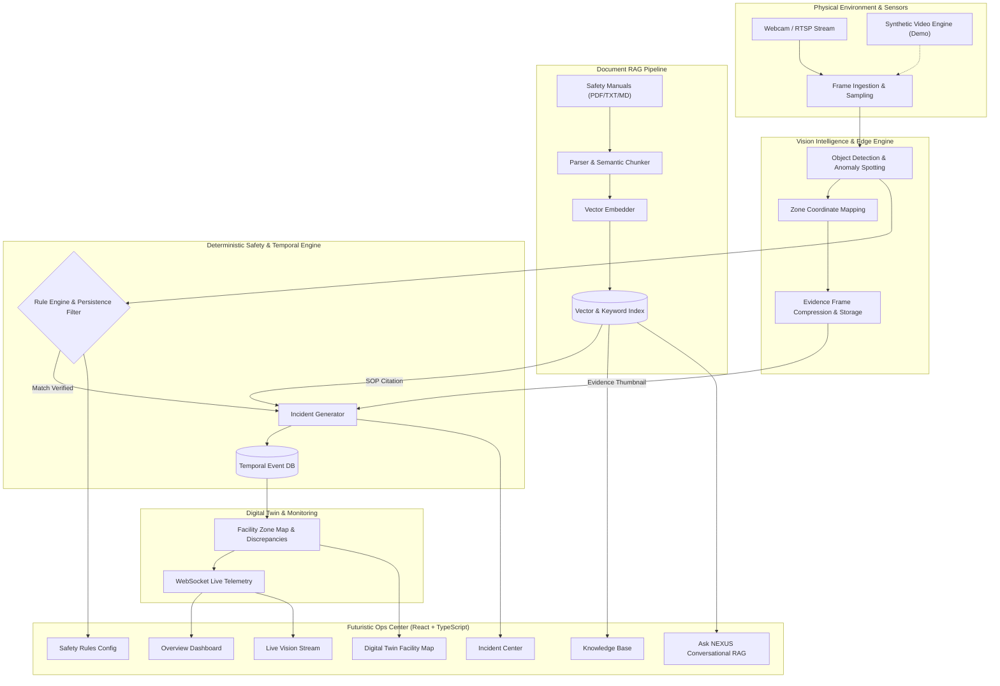

# NEXUS — See. Remember. Protect.

[](https://github.com/seeman-shingeri/nexus-rag/actions/workflows/ci.yml)
[](LICENSE)
[](https://python.org)
[](https://fastapi.tiangolo.com)
[](https://react.dev)
[](https://www.typescriptlang.org)
[](https://tailwindcss.com)

> **Privacy-first multimodal RAG safety intelligence platform combining real-time computer vision, temporal event memory, explainable safety alerts, and evidence-grounded AI.**

---

## 1. Executive Overview

**NEXUS** bridges the gap between what artificial intelligence observes in the physical world and what it understands from structured compliance documentation, standard operating procedures (SOPs), and historical facility memory.

Rather than relying on ungrounded generative models or opaque black-box alerts, NEXUS couples **real-time visual perception** with a **deterministic safety engine** and a **vector-grounded document retrieval pipeline (RAG)**. Every hazard alert, discrepancy report, and procedural recommendation is accompanied by an audit trail containing:
1. Exact visual observation timestamp and camera identifier.
2. Verified confidence score and bounding-box coordinates.
3. Rule-matching logic with persistence and hysteresis cooldown.
4. Verifiable citations to ingested safety manuals and regulatory standards.
5. Mandatory human verification protocols before any high-impact escalation.



---

## 2. Core Capabilities

- **Live Vision Intelligence**: Real-time browser webcam streaming and video stream analysis detecting individuals, machinery, liquid spills/hazards, obstructions, and missing PPE proxies with clear visual demarcation.
- **Explainable Safety Alerts**: Strict deterministic logic calculates observation persistence and cooldown deduplication before firing an incident. Never invents detections.
- **Evidence-Grounded Document RAG**: Parses PDFs, Markdown, and text compliance documents, performs hybrid vector + BM25 keyword search, and generates answers citing exact paragraphs. Explicitly refuses when evidence is insufficient.
- **Temporal Facility Memory**: Searchable event history enabling time-bounded queries (e.g. *"What changes occurred in Zone 2 between 14:00 and 16:00?"*).
- **Interactive Digital Twin**: Visualizes spatial zones, monitored equipment, expected facility conditions, and real-time discrepancy alerts.
- **Privacy by Design & RBAC**: Role-Based Access Control (`ADMIN`, `SAFETY_OFFICER`, `OPERATOR`, `VIEWER`), automated evidence retention policies, zero biometric identification, and audit logging.
- **Zero-Dependency Standalone Mode**: Runs out of the box with SQLite and local embedding/deterministic response generation, with instant toggle to PostgreSQL + pgvector and Google Gemini LLM API.

---

## 3. Technology Stack

| Layer | Technology | Purpose |
|---|---|---|
| **Frontend** | React 18, TypeScript, Vite, Tailwind CSS, Lucide Icons | High-performance, dark navy futuristic AI operations dashboard |
| **Backend** | Python 3.12, FastAPI, Pydantic v2, Uvicorn | Asynchronous REST API, WebSocket pub/sub, validation |
| **Database** | SQLAlchemy 2.0, SQLite (local) / PostgreSQL with pgvector (prod) | Relational event store, vector embeddings, audit trail |
| **Vision** | OpenCV, NumPy, Haar/DNN detection proxies, synthetic demo engine | Edge frame processing, bounding boxes, snapshot extraction |
| **RAG & Search** | NumPy vector cosine similarity, BM25 ranker, chunking engine | Hybrid semantic + keyword retrieval with document citations |
| **AI Providers** | Google Gemini (`google-genai`) & Local Deterministic Engine | Multi-model strategy supporting air-gapped and cloud setups |
| **Security** | Python-jose (JWT), Passlib / Cryptography, RBAC middleware | Authentication, role authorization, rate limiting, sanitization |

---

## 4. Quick Start Guide

### Prerequisites
- **Node.js** v18+ (tested with v26)
- **Python** 3.10+ (managed via `uv` or system Python)

### Step 1: Clone & Configure
```bash
git clone https://github.com/seeman-shingeri/nexus-rag.git
cd nexus-rag
cp .env.example .env
```

### Step 2: Backend Setup
```bash
cd backend
# Create virtual environment and install dependencies
uv venv
source .venv/bin/activate  # On Windows: .venv\Scripts\activate
uv pip install -r requirements.txt

# Seed initial database with sample safety SOPs and zones
python seed_db.py

# Launch FastAPI backend
uvicorn main:app --reload --port 8000
```
Backend API interactive documentation will be available at: `http://localhost:8000/docs`

### Step 3: Frontend Setup
```bash
cd ../frontend
npm install
npm run dev
```
Open your browser to: `http://localhost:5173`

Default credentials for testing:
- **Admin**: `admin@nexus.ai` / `NexusAdmin@2026`
- **Safety Officer**: `officer@nexus.ai` / `OfficerSafety@2026`
- **Operator**: `operator@nexus.ai` / `OperatorDuty@2026`

---

## 5. Project Structure

```text
nexus-rag/
├── .github/
│   └── workflows/
│       └── ci.yml               # Automated linting, test suite, and build checks
├── backend/
│   ├── app/
│   │   ├── api/                 # REST & WebSocket endpoints
│   │   ├── core/                # Config, security, JWT, database session
│   │   ├── models/              # SQLAlchemy database models
│   │   ├── schemas/             # Pydantic request/response schemas
│   │   ├── services/
│   │   │   ├── rag_service.py   # Ingestion, chunking, embeddings, hybrid retrieval
│   │   │   ├── vision_service.py# Frame processing, object detection, demo stream
│   │   │   ├── safety_engine.py # Deterministic rules, cooldown, persistence
│   │   │   └── twin_service.py  # Facility digital twin & anomaly detector
│   │   └── tests/               # Backend pytest test suite
│   ├── storage/                 # Document uploads & evidence snapshots
│   ├── main.py                  # FastAPI application entrypoint
│   ├── requirements.txt         # Pinned backend dependencies
│   └── seed_db.py               # Seed synthetic initial data & rules
├── frontend/
│   ├── src/
│   │   ├── components/          # Reusable UI cards, modal, badges, navigation
│   │   ├── pages/               # 8 Core Operational Views
│   │   │   ├── Dashboard.tsx    # System overview & live telemetry
│   │   │   ├── LiveVision.tsx   # Camera feed & bounding overlays
│   │   │   ├── KnowledgeBase.tsx# Document upload, indexing & citation preview
│   │   │   ├── IncidentCenter.tsx# Incident triaging & review workflows
│   │   │   ├── AskNexus.tsx     # Conversational grounded RAG
│   │   │   ├── DigitalTwin.tsx  # Interactive zone map & discrepancies
│   │   │   ├── SafetyRules.tsx  # Deterministic rule configuration
│   │   │   └── Settings.tsx     # RBAC, audit logs, privacy controls
│   │   ├── services/            # Axios API client & WebSocket listener
│   │   ├── types/               # TypeScript data definitions
│   │   └── App.tsx              # Router & layout container
│   ├── package.json
│   ├── tailwind.config.js
│   └── vite.config.ts
├── docs/
│   ├── ARCHITECTURE.md          # In-depth architectural specifications
│   ├── PRIVACY.md               # Data minimization, retention & audit rules
│   ├── TESTING.md               # Verification procedures & automated suites
│   └── DEPLOYMENT.md            # Production deployment guidelines
├── .env.example
├── .gitignore
├── DEVELOPMENT_LOG.md           # Continuous audit trail of verified commits
├── LICENSE                      # MIT Open Source License
├── README.md
└── SECURITY.md                  # Responsible vulnerability reporting
```

---

---

## 6. Milestone Verification & Architecture Ledger

Every milestone was developed, tested, committed, pushed, and cryptographically verified against the remote repository at [`https://github.com/seeman-shingeri/nexus-rag.git`](https://github.com/seeman-shingeri/nexus-rag.git):

| Milestone | Contribution / Scope | Automated Tests & Checks | Remote Commit Hash | Status |
|---|---|---|---|---|
| **M1** | Project Foundation, Architecture Specs, CI/CD, and Development Ledger | Git workflow validation, markdown lints | `35d67c74e75d048ea6181f629c1181283d69eeef` | Verified |
| **M2** | FastAPI Backend Skeleton, Async SQLAlchemy 2.0 Models, JWT & RBAC Middleware | 10 backend pytest tests passed | `0c10fea7d7880d0032f06c774b8a08f5d1ab693c` | Verified |
| **M3** | Document Ingestion (PDF/MD/TXT), Dense Vector Embeddings, Hybrid Retrieval & Grounded RAG | 17 backend pytest tests passed | `60335babe196b2e25cb6052097477544df87fc19` | Verified |
| **M4** | Core Frontend Dashboard, Knowledge Base, and Ask NEXUS Grounded Q&A | Frontend build in 3.23s, clean TypeScript | `25019bb020b37823f524c45158d1fa9937bc1d19` | Verified |
| **M5** | Webcam Stream Capture, OpenCV Object Detection Overlays & Synthetic Demo Video Engine | 21 backend pytest tests, build in 3.63s | `14c9debafe3f728a6078c36581d508c47d4f877d` | Verified |
| **M6** | Event Persistence, Time-Window Temporal Event Queries & Incident Center Review Workflows | 24 backend pytest tests, build in 4.46s | `4839169b80069ef1b9e7b7afe5adf095a81df04d` | Verified |
| **M7** | Deterministic Safety Engine, Persistence Duration Tracking & Rule Simulation Sandbox | 27 backend pytest tests, build in 3.60s | `926e634dcf32a416948e83645ef608d3f11d5246` | Verified |
| **M8** | Facility Digital Twin Map, Spatial Anomaly Detection & Zone Discrepancy Inspector | 30 backend pytest tests, build in 3.95s | `3845faa917c103cbf95fcbdd85fde460fe1af91e` | Verified |
| **M9** | Security Settings, Operator RBAC Roster, Optical Privacy Blurring & Immutable Audit Log | 32 backend pytest tests, build in 4.09s | `f7901f415050884754c63f6aa48e3e7362e011c2` | Verified |
| **M10**| End-to-End System Verification, Production Hardening & Final Documentation | 32/32 backend tests passed, clean frontend build | `c8f6fbb03f2b38f74956a410a59062b509eaac7e` | Verified |
| **M11**| Vercel Deployment Hardening & HTTP 500 Fix (Decoupled SPA & .vercelignore) | 32/32 backend tests passed, live Vercel HTTP 200 OK verified | `a06e9f9af1159846d1b96f568df42452a169d338` | Verified |
| **M12**| Premium Industrial UI Redesign & Authentic Enterprise Design System | 32/32 backend tests passed, live Vercel HTTP 200 OK verified | `43c6b46838ad7127429c581997a943229b8965b4` | Verified |
| **M13**| Live Vision Camera Initialization Bug Fix, MediaStream Visible Playback & Lifecycle Hardening | 9/9 camera tests passed, 32 backend tests passed, clean build | `d016a7dfaf6e60fc59ec70416eb5f87642ada87e` | Verified |


---

## 7. Verification & Testing

Run all unit, integration, and security tests:

```bash
# Backend test suite (32 passing tests)
cd backend
pytest -v

# Frontend production build check
cd ../frontend
npm run build
```

---

## 8. Responsible Safety & Privacy Principles

- **No Hallucinated Safety Alerts**: The deterministic rule engine evaluates raw visual bounding boxes, confidence levels, and temporal persistence ($N$ seconds) independently from free-form generative LLMs.
- **Strict Human-in-the-Loop**: High-impact facility decisions (quarantining zones, dispatching emergency responders) require verified sign-off from an authorized Safety Officer or Admin.
- **Zero Raw Video Perpetuity**: NEXUS extracts compact structured event descriptors and metadata; raw camera frames are automatically purged according to the configurable retention schedule (e.g. 30 days) to prevent mass surveillance risks.
- **Privacy Anonymization**: Facial and identity regions can be automatically masked and blurred upon ingestion for GDPR and employee privacy compliance.

---

## 9. License

Distributed under the MIT License. See [LICENSE](LICENSE) for details.

