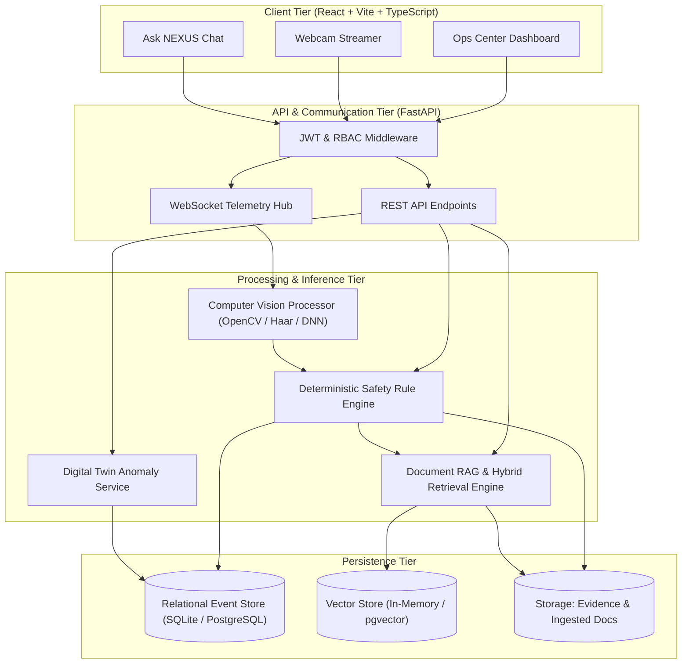

# NEXUS Architecture Specification

## 1. Architectural Philosophy

NEXUS is engineered as a **defensive, multimodal safety intelligence system**. It is designed around four inviolable tenets:
1. **Explainable Grounding**: No alert may be issued without deterministic rule matching and verifiable evidence.
2. **Dual-Path Intelligence**: Visual perception feeds a deterministic safety engine; free-form generative LLMs are strictly used for explanation and document Q&A, never for unsupervised actuation.
3. **Temporal Coherence**: Observations are tracked over sliding time windows (persistence and cooldown hysteresis) to eliminate alert spam and false alarms.
4. **Privacy and Minimal Retention**: Continuous raw video is discarded immediately; only downsampled, bounded evidence snapshots of verified incidents are retained under configurable expiration policies.

---

## 2. Component Topology

---

## 3. Subsystem Breakdown

### 3.1 Live Vision Processor (`vision_service.py`)
- Ingests video frames from WebRTC/WebSocket client streams or backend cameras.
- Applies localized object detection across supported classes: `person`, `machinery`, `liquid_spill`, `fire_smoke_suspicion`, `missing_ppe_helmet`, `missing_ppe_vest`, `blocked_exit`.
- Emits bounding box coordinates $[x, y, w, h]$, class label, and calibrated confidence score $\in [0, 1]$.
- Includes a synthetic demo generator for development and testing environments without cameras.

### 3.2 Deterministic Safety Engine (`safety_engine.py`)
- Evaluates raw detection streams against user-configured rules.
- **Persistence Verification**: A detection must persist for a minimum threshold (e.g., $\ge 3$ consecutive seconds) before qualifying as a candidate alert.
- **Cooldown & Deduplication**: Once an incident is triggered for a zone/category, identical detections are grouped into the active incident for a configurable cooldown window (e.g., 5 minutes) rather than generating duplicate alerts.
- **Automatic SOP Linking**: Automatically invokes the RAG engine to locate the governing Standard Operating Procedure and injects citations into the incident record.

### 3.3 Document RAG Pipeline (`rag_service.py`)
- Ingests PDF, Markdown, and TXT manuals.
- Performs semantic text chunking (500-token chunks with 100-token overlap).
- Generates dense vector embeddings.
- Implements **Hybrid Retrieval**: Combines dense vector cosine similarity with BM25 keyword matching using reciprocal rank fusion.
- Grounded generation: Synthesizes direct answers citing source title and chunk identifier. Explicitly returns an insufficient-evidence refusal if similarity falls below threshold.

### 3.4 Temporal Memory & Digital Twin (`twin_service.py`)
- Maintains spatial representation of facility zones (e.g., Workshop, Chemical Storage, Walkway).
- Evaluates discrepancies between expected zone states (e.g. "Restricted Zone - No Personnel Allowed") and current observations.
- Supports temporal point-in-time replay and time-bounded incident aggregation.
